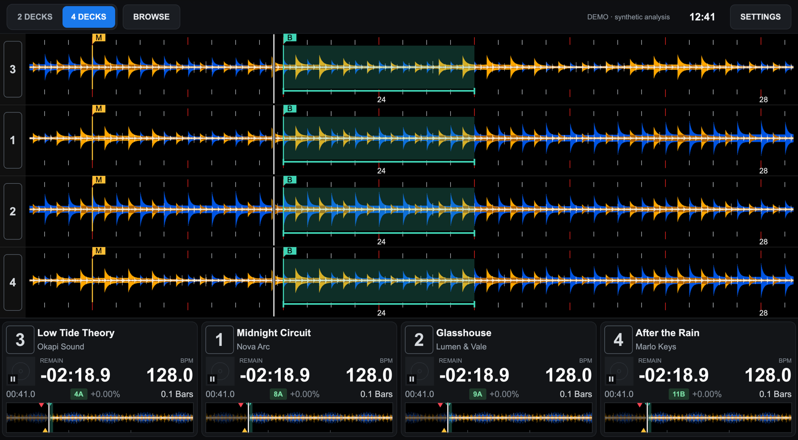
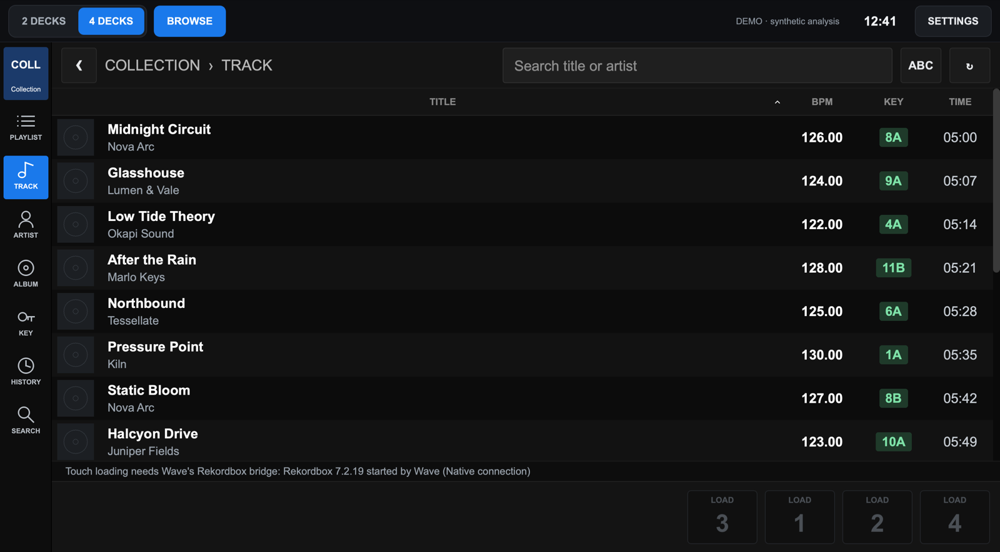
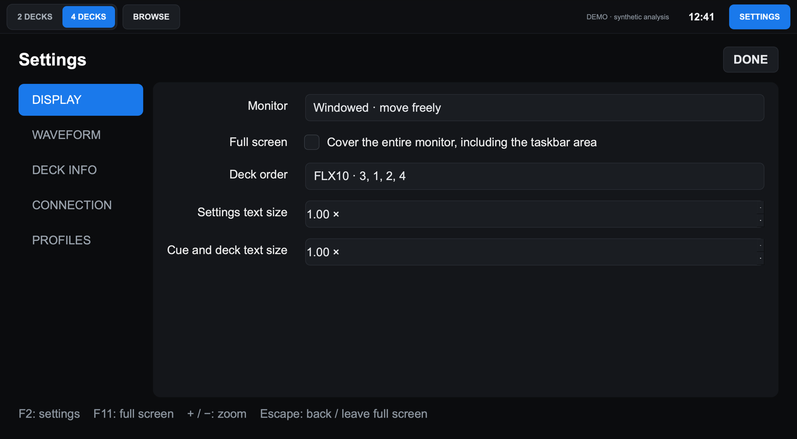

# Rekordbox Wave

**A full-screen, touch-friendly deck screen for Rekordbox, in the style of the XDJ-AZ.**
Big three-band waveforms for two or four decks, an AZ-style info bar, and a touch browser that loads
tracks straight into Rekordbox. Rekordbox stays the audio engine and keeps your controller; Wave is
the screen.

[**Download the latest release**](https://github.com/palermostest25/rkbx_wave_den/releases/latest) ·
Windows 10/11 (x64) · macOS (Apple Silicon and Intel)



## What it does

- **Waveforms like the AZ:** Rekordbox's own three-band colours and scale, beat grid, bar numbers,
  hot cues, memory cues and loops, zoomable from 1 to 128 bars. Two or four decks, in any order (FLX10 default 3, 1, 2, 4).
- **Deck info bar:** artwork, title and artist, time remaining or elapsed, BPM, key and key shift,
  tempo and tempo range (±6 / ±10 / ±16 / WIDE), MASTER, SYNC and MT (tap MT to toggle key lock),
  loop state, a bar countdown and a track overview that warns near the end.
- **Touch browser:** your collection or a USB stick, by playlist, history, artist, album or key, with
  search, an on-screen keyboard and sorting. Tap a deck to load the selected track.
- **Works with your controller:** turn the browse knob and Wave's browser follows Rekordbox's cursor;
  LOAD, BACK and everything else work as they always do. Tested with a DDJ-FLX10.
- **Made for a second screen:** pick a monitor and Wave fills it, every time it is plugged in.



## What you need

- **Rekordbox 7.2.19**, installed normally. Wave reads Rekordbox's engine directly and checks the exact
  build first; with any other version it says so and stays off rather than guess. (Without the bridge,
  Windows falls back to an older reader for Rekordbox 7.2.2 and 7.2.14 and macOS to a read-only screen
  reader, both with fewer features and no touch loading.)
- Windows 10 or 11 (64-bit), or macOS 14 Sonoma or later.
- A touchscreen is optional: everything also works with a mouse.

## Install

### Windows

1. Download **`Rekordbox-Wave-Windows-x64.exe`** from the
   [latest release](https://github.com/palermostest25/rkbx_wave_den/releases/latest).
2. Double-click it. The app is not code-signed, so Windows SmartScreen may say *"Windows protected your
   PC"*: click **More info → Run anyway**. Nothing is installed; you can keep the `.exe` anywhere
   (on the desktop, for example) and delete it to uninstall.

### macOS

1. Download the DMG for your Mac from the
   [latest release](https://github.com/palermostest25/rkbx_wave_den/releases/latest):
   **Apple Silicon** (M1 and later) or **Intel**. Not sure? Apple menu → About This Mac → *Chip*.
2. Open it and drag **Rekordbox Wave** to **Applications**.
3. Open it from Applications. The app is not notarized by Apple, so the first time macOS says it
   *cannot verify* it: click **Done**, then open **System Settings → Privacy & Security**, scroll down,
   click **Open Anyway** next to Rekordbox Wave and confirm. You only do this once.

### Updates

From 2.3.3, Wave checks GitHub for a newer release when it starts and every few hours. When there is
one, an **UPDATE** button appears at the top. Press it, with the decks stopped, and Wave downloads the
release for your computer, checks it against GitHub's published SHA-256, swaps itself out and restarts.
Rekordbox keeps running, and Wave reconnects to it. To check right away, press **CHECK FOR UPDATES**
in **Settings → Connection**, which is also where you can turn the automatic check off.
Earlier versions need one manual download.

## First run

1. **Quit Rekordbox** if it is open (Wave needs to start it).
2. Open **Rekordbox Wave**. It starts Rekordbox for you, minimised behind Wave, with Wave's bridge.
   After a few seconds the status at the top shows **REKORDBOX · direct**.
3. Load and play tracks as usual. Wave follows every deck.

If Rekordbox was already running, Wave shows a **CONNECT** button: press it and Wave restarts
Rekordbox with the bridge (it asks first; Rekordbox asks too if a deck is playing).
To see Rekordbox itself (for its preferences, for example), use **Settings → Connection → SHOW REKORDBOX**.

## Using Wave

| To | Do this |
| --- | --- |
| Browse and load | **BROWSE**, pick a source and category, tap a track, then tap a deck's **LOAD** button. Once the track is on the deck, Wave goes back to the waveforms. Wave never loads onto a playing deck. |
| Browse from the controller | Turn the **browse knob**: Wave's browser opens and follows Rekordbox. Press **LOAD** on the controller as usual. |
| Toggle key lock | Tap **MT** on a deck. |
| Zoom the waveforms | Pinch, scroll over them, press **+ / −**, or (macOS) **SHIFT + BROWSE** on the controller. |
| Two or four decks | **2 DECKS / 4 DECKS** at the top. Change the order in Settings → Display. |
| Use a second monitor | Settings → Display → **Monitor**. Wave fills it whenever it is connected. |
| Settings | **SETTINGS** or **F2**. **Escape** goes back; **F11** toggles full screen. |



Settings are saved automatically in `%APPDATA%\rkbx_wave` (Windows) or
`~/Library/Application Support/rkbx_wave` (macOS), and can be exported as profiles.

## Is it safe for my library?

- Wave opens Rekordbox's library **read-only**. It never writes to it.
- It never modifies Rekordbox's files. The bridge is a small library Rekordbox loads when Wave starts it,
  only for that session. Start Rekordbox normally and it runs exactly as before, without Wave.
- The bridge only runs on the exact Rekordbox build it was checked against (it compares Rekordbox's code
  before doing anything) and stops itself, never Rekordbox, if anything goes wrong.
- Loading from Wave goes through Rekordbox's own load, as its browser does, and is refused on a playing deck.

## Troubleshooting

| You see | Do this |
| --- | --- |
| *Unsupported Rekordbox build* | Install Rekordbox 7.2.19. Wave's bridge supports that build only. |
| *Rekordbox is waiting: answer its questions* | Rekordbox stopped at one of its own startup questions (library sync, My Tag and so on). Wave brings it forward: answer it, and Wave connects and comes back. |
| *Quit Rekordbox and press CONNECT* | Rekordbox was started without Wave. Press **CONNECT**, or quit Rekordbox and reopen Wave. |
| *Rekordbox was not found* (Windows) | Wave looks in `C:\Program Files\rekordbox`. Start Rekordbox yourself once, then press **CONNECT**: Wave restarts it from wherever it is installed. |
| Load buttons greyed out | The deck is playing, or Rekordbox isn't connected through the bridge (see above). |
| A track shows no waveform | Analyse it in Rekordbox first. Wave draws Rekordbox's own analysis. |

Still stuck? [Open an issue](https://github.com/palermostest25/rkbx_wave_den/issues/new/choose) with your
OS, Rekordbox version and the status text Wave shows.

## Current limits

- **Windows:** the bridge is new in 2.3 and still being tested on hardware. Try it at home before a gig.
- **Windows:** SHIFT + BROWSE zoom isn't available, because Windows lets only one app use the controller.
- Wave shows Rekordbox; it doesn't replace it. Playback, effects and the mixer stay in Rekordbox.

## Build from source

Python 3.10 or later (releases use 3.12).

```sh
python -m pip install .
python rkbx_wave.py            # or: python rkbx_wave.py --demo  (synthetic decks, no Rekordbox needed)
python -m unittest discover -s tests
```

Packaging (`python -m pip install pyinstaller`, then `python scripts/build_app.py`) makes
`Rekordbox Wave.exe` on Windows and `Rekordbox Wave.app` on macOS. The bridges live in `native/`:
`native/mac_bridge/build.sh` builds the macOS library, and CI builds the Windows DLL with MSVC
(see `.github/workflows/build.yml`). Pushing a `v*` tag builds every platform and drafts a release.

### OSC input

**Settings → Connection → OSC** listens on localhost UDP 4460 for another tool to drive the display
(deck IDs are zero-based): `/track/0/anlz_path`, `/time/0`, `/bpm/0/current`, `/bpm/0/original`,
`/playing/0`, `/rate/0`, and `/loop/0` (start seconds, end seconds, enabled).

## Credits

A fork of [mrmilbe/rkbx_wave](https://github.com/mrmilbe/rkbx_wave) (MIT; original notices retained).
Uses [pyrekordbox](https://github.com/dylanljones/pyrekordbox), Qt / PySide6 under the
[LGPL](https://www.qt.io/licensing/open-source-lgpl-obligations), and memory layouts from
[rkbx_link](https://github.com/grufkork/rkbx_link). Waveform format references:
[Deep Symmetry](https://djl-analysis.deepsymmetry.org/djl-analysis/track_metadata.html).

Rekordbox, XDJ-AZ and DDJ-FLX10 are trademarks of AlphaTheta Corporation. This project is not
affiliated with or endorsed by AlphaTheta.
