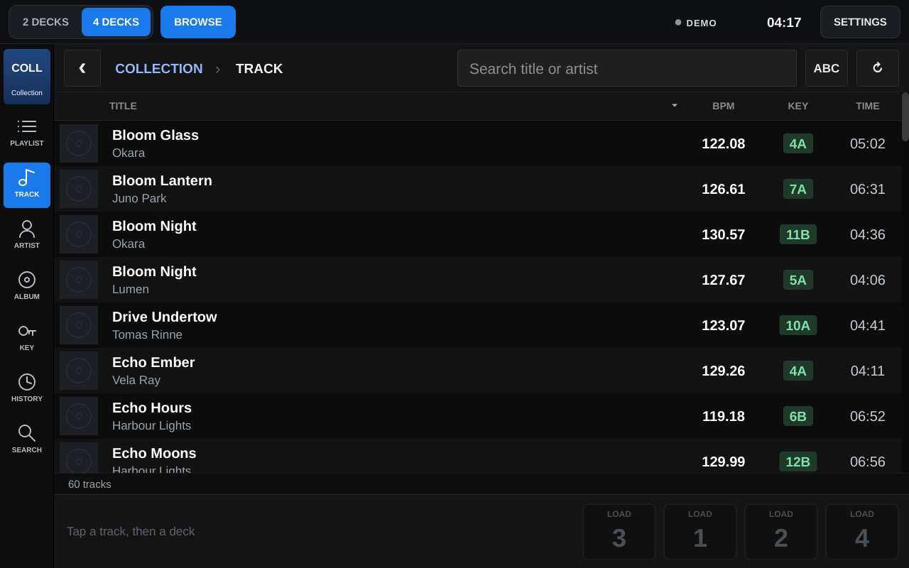
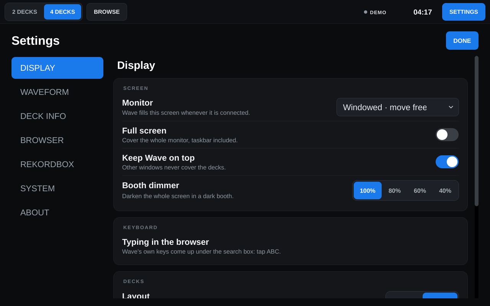

# Rekordbox Wave

**A full-screen, touch-friendly deck screen for Rekordbox, in the style of the XDJ-AZ.**
Big three-band waveforms for two or four decks, an AZ-style info bar, and a touch browser driven by your
controller's browse knob. Install it, open it, and nothing else: Wave installs the Rekordbox it supports
if you don't have it, starts Rekordbox behind itself, connects to it, keeps it running and handles its
popups. Rekordbox stays the audio engine and keeps your controller; Wave is the screen.

**New in 3.0:** Wave is native C++ now. It draws only while something on screen moves and uses a fraction
of the CPU the earlier versions did (about a fifth with four decks playing), so a Surface or laptop stays
cool through a set. Your settings carry over.

[**Download the latest release**](https://github.com/palermostest25/rkbx_wave_den/releases/latest) ·
Windows 10/11 (x64) · macOS (Apple Silicon and Intel)


## What it does

- **Waveforms like the AZ:** Rekordbox's own three-band colours and scale, beat grid, bar numbers,
  hot cues, memory cues and loops, zoomable from 1 to 128 bars. Two or four decks, in any order (FLX10 default 3, 1, 2, 4).
- **Deck info bar:** artwork, title and artist, time remaining or elapsed, BPM, key and key shift,
  tempo and tempo range (±6 / ±10 / ±16 / WIDE), MASTER, SYNC and MT (tap MT to toggle key lock),
  loop state, a bar countdown and a track overview that warns near the end.
- **Touch browser, driven by the controller:** your collection or a USB stick, by playlist, history,
  artist, album or key, with search and your choice of keyboard: Wave's own keys, or Windows' touch
  keyboard. Turn the controller's browse knob and Wave's browser opens and its highlight moves; push the
  knob to open a playlist, and on a track to load it onto that deck; BACK goes up, VIEW opens and closes
  it. Rekordbox's own browser doesn't move meanwhile. Or tap a track and a deck's LOAD button on screen.
- **Beatport and Spotify:** the BEATPORT and SPOTIFY tiles in Wave's browser bring Rekordbox's own browser
  over Wave on that service (sign in there the first time; Rekordbox shows only then). Load a track and Wave
  is back on the waveforms, with the streamed track's waveform once Rekordbox has analysed it.
- **Or Rekordbox's own browser, over Wave** (Settings › Browser): it goes away by itself after a load.
- **Touch preview:** touch or drag a deck's whole-track overview to see that part of the track in its
  lane; it glides back to the playhead when you let go. Tap the big time to flip remaining and elapsed.
- **Hands-off Rekordbox:** Wave starts Rekordbox hidden behind it, connects to one you started yourself
  (on Windows without restarting it), starts it again if it ever closes, and quits it when Wave quits.
- **Popups handled:** Rekordbox's notices, update prompts and offers are closed for you. A real question
  is put in front of Wave, and Wave comes back by itself once it is answered.
- **Works with your controller:** everything works as it always does. Tested with a DDJ-FLX10.
- **Made for a second screen:** pick a monitor and Wave fills it, every time it is plugged in.
- **Built for gigs:** the screen never sleeps while Wave runs, a booth dimmer, the battery level with a
  warning the moment the charger comes out, the tempo master's BPM in the top bar, a second Wave just
  brings the first one forward, and everything Wave does is logged (Settings › System › OPEN LOG).



## What you need

- **Rekordbox 7.2.19.** Wave reads Rekordbox's engine directly and checks the exact build first; with any
  other version it says so and stays off rather than guess. You don't need to install it yourself: Wave
  offers to, and on Windows it can sit beside a newer Rekordbox (Wave starts 7.2.19).
- Windows 10 or 11 (64-bit), or macOS 12 Monterey or later.
- A touchscreen is optional: everything also works with a mouse.

## Install

### Windows

1. Download **`Rekordbox-Wave-Setup-Windows-x64.exe`** from the
   [latest release](https://github.com/palermostest25/rkbx_wave_den/releases/latest).
2. Run it. It installs for you only (no administrator needed), adds Wave to the Start menu and,
   if you like, the desktop, and can start Wave when you sign in. Uninstall it from
   **Settings → Apps** like any other app. The installer is not code-signed yet, so Windows SmartScreen
   may say *"Windows protected your PC"*: click **More info → Run anyway**.
3. If Rekordbox 7.2.19 isn't installed, leave **Download and install Rekordbox 7.2.19** ticked. The
   installer downloads AlphaTheta's own Rekordbox installer (about 660 MB, hosted unmodified on this
   project's [Rekordbox 7.2.19 pre-release](https://github.com/palermostest25/rkbx_wave_den/releases/tag/rekordbox-7.2.19)),
   checks its fingerprint, and runs it (Windows asks for permission). Already have Rekordbox 7.2.19? The
   option isn't offered. Wave can also install it later from **Settings → Rekordbox**.

Prefer no installer? **`Rekordbox-Wave-Windows-x64.exe`** is the same app as a single file that runs
from anywhere. Press its **INSTALL** button (top right, or Settings → System) to put it in
`C:\Program Files\Rekordbox Wave` with Start menu and desktop shortcuts; Windows asks for permission
once, and it can be removed from **Settings → Apps**.

### macOS

1. Download the DMG for your Mac from the
   [latest release](https://github.com/palermostest25/rkbx_wave_den/releases/latest):
   **Apple Silicon** (M1 and later) or **Intel**. Not sure? Apple menu → About This Mac → *Chip*.
2. Open it and drag **Rekordbox Wave** to **Applications**.
3. Open it from Applications. The app is not notarized by Apple, so the first time macOS says it
   *cannot verify* it: click **Done**, then open **System Settings → Privacy & Security**, scroll down,
   click **Open Anyway** next to Rekordbox Wave and confirm. You only do this once.

### Updates

From 2.3.3, Wave checks GitHub for a newer release when it starts and every few hours. When there is
one, an **UPDATE** button appears at the top. Press it, with the decks stopped, and Wave downloads the
release for your computer, checks it against GitHub's published SHA-256, swaps itself out and restarts.
Rekordbox keeps running, and Wave reconnects to it. To check right away, press **CHECK FOR UPDATES**
in **Settings → System**, which is also where you can turn the automatic check off.
Earlier versions need one manual download. Wave's version is in its window title and in **Settings → About**.

## First run

1. Open **Rekordbox Wave**. That's all: Wave starts Rekordbox out of sight behind it, with Wave's
   bridge. After a few seconds the light at the top turns green: **● REKORDBOX**.
2. Load and play tracks as usual. Wave follows every deck.

If Rekordbox was already running when Wave opened:

- **Windows:** Wave connects to it as it is, with no restart.
- **macOS:** Wave restarts it with the bridge if no deck has a track; otherwise a **CONNECT** button
  appears for when you are ready (Rekordbox still asks first if a deck is playing).

The first time on macOS, allow Wave in **System Settings → Privacy & Security → Accessibility**: Wave
uses it to read and close Rekordbox's popups. To see Rekordbox itself (for its preferences, for example),
use **Settings → Rekordbox → SHOW REKORDBOX**. Every one of these behaviours can be switched off there.

## Using Wave

| To | Do this |
| --- | --- |
| Browse and load | **BROWSE**, pick a source and category, double-tap a playlist to open it (single tap in Settings › Browser), tap a track, tap a deck's **LOAD**. Drag to scroll. Once the track is on the deck, Wave goes back to the waveforms. Wave never loads onto a playing deck. |
| Browse from the controller | Turn the **browse knob** (Wave's browser opens), push it to open a playlist, push it on a track to load that track onto the deck the push belongs to (or press that deck's **LOAD**), **BACK** to go up a level (at the top it closes the browser), **VIEW** to open and close it. While Wave's browser has the controls, Rekordbox's own browser doesn't move with them. Settings › Browser › *Controller* says what Wave hears. |
| Go back several levels | Tap any level in the path at the top of the browser (COLLECTION › PLAYLIST › Gigs › …). |
| Use Rekordbox's own browser | Settings › Browser › **Rekordbox's browser**: BROWSE (or the knob) then brings Rekordbox's browser over Wave, and it goes away after a load. |
| Preview another part of a track | Touch or drag the deck's overview, at the bottom of its panel. |
| Remaining or elapsed time | Tap the big time on a deck. |
| Toggle key lock | Tap **MT** on a deck. |
| Zoom the waveforms | Pinch, scroll over them, press **+ / −**, turn the controller's **sampler volume** knob (its middle is your zoom, its ends 1 and 32 bars), or **SHIFT + BROWSE**. The controller ones need Wave to read the controller itself. |
| Use Rekordbox itself | **REKORDBOX** at the top: Rekordbox comes in front. Tap Wave to come back. |
| Two or four decks | **2 DECKS / 4 DECKS** at the top. Change the order in Settings → Display. |
| Use a second monitor | Settings → Display → **Monitor**. Wave fills it whenever it is connected. |
| Type with Windows' touch keyboard | Settings → Display → *Typing in the browser* → **Windows touch keyboard**: tapping the search box brings it up. With **Wave's keyboard**, Windows' own is turned off while Wave runs and put back when it closes (Settings → Display shows both). |
| Settings | **SETTINGS** or **F2**. **Escape** goes back; **F11** toggles full screen. |



Settings are saved automatically in `%APPDATA%\rkbx_wave` (Windows) or
`~/Library/Application Support/rkbx_wave` (macOS), and can be exported as profiles.

## Is it safe for my library?

- Wave opens Rekordbox's library **read-only**. It never writes to it.
- It never modifies Rekordbox's files. The bridge is a small library Rekordbox loads when Wave starts it,
  only for that session. Start Rekordbox normally and it runs exactly as before, without Wave.
- The bridge only runs on the exact Rekordbox build it was checked against (it compares Rekordbox's code
  before doing anything) and stops itself, never Rekordbox, if anything goes wrong.
- Loading from Wave goes through Rekordbox's own load, as its browser does, and is refused on a playing deck.

## Troubleshooting

| You see | Do this |
| --- | --- |
| *Unsupported Rekordbox build* | Install Rekordbox 7.2.19. Wave's bridge supports that build only. |
| *Rekordbox asks: …* (orange line) | Rekordbox asked something Wave won't answer for you (library sync, sign-in and so on). Wave has put it in front: answer it, and Wave comes back by itself. |
| *Closed a Rekordbox notice: …* | Wave closed a notice or offer for you. To answer these yourself, turn off Settings › Rekordbox › *Close Rekordbox's notices and offers*. |
| **CONNECT** button | Rekordbox was started without Wave and has tracks loaded, so Wave won't restart it alone (macOS, or Windows if connecting live failed). Stop the decks and press **CONNECT**. |
| *Rekordbox was not found* (Windows) | Wave looks in `C:\Program Files\rekordbox`. Start Rekordbox yourself once, then press **CONNECT**: Wave restarts it from wherever it is installed. |
| Load buttons greyed out | The deck is playing, or Rekordbox isn't connected through the bridge (see above). |
| A track shows no waveform | Analyse it in Rekordbox first. Wave draws Rekordbox's own analysis. |
| Something else | Settings › System › **OPEN LOG**, and attach `wave.log` to an issue. |

Still stuck? [Open an issue](https://github.com/palermostest25/rkbx_wave_den/issues/new/choose) with your
OS, Rekordbox version and the status text Wave shows.

## Current limits

- **Windows:** the bridge is new in 2.3 and still being tested on hardware, and connecting live to a running
  Rekordbox is new in 2.5. Try it at home before a gig.
- **Windows:** Rekordbox's browser is its Split Screen window when it is open (View › Show Split Screen,
  once), otherwise Rekordbox's main window, laid over Wave below Wave's toolbar.
- **Windows:** Rekordbox holds the controller, so Wave hears it through its bridge inside Rekordbox, which
  also keeps the browser controls (knob, push, BACK, VIEW, LOAD) from Rekordbox while Wave runs. Everything
  else on the controller is Rekordbox's as always. If Wave quits, Rekordbox has them back within a second.
  After updating Wave, let Wave restart Rekordbox once (CONNECT) so the new bridge is loaded.
- Wave shows Rekordbox; it doesn't replace it. Playback, effects and the mixer stay in Rekordbox.

## Build from source

Wave is C++20 with Qt 6 (`app/`; see [app/README.md](app/README.md)). SQLCipher is built in.

```sh
cmake -S app -B app-build -G Ninja -DCMAKE_BUILD_TYPE=Release
cmake --build app-build
"app-build/Rekordbox Wave" --demo          # synthetic decks, no Rekordbox needed
QT_QPA_PLATFORM=offscreen ctest --test-dir app-build --output-on-failure
```

Releases build Windows as one static exe (Qt from vcpkg) and macOS as an app bundle; see
`.github/workflows/build.yml`. The bridges live in `native/`: `native/mac_bridge/build.sh` builds the
macOS library, and CI builds the Windows DLL with MSVC. The Python app it replaced is still in
`rb_waveform_core/`, with its tests, for reference.

## Credits

A fork of [mrmilbe/rkbx_wave](https://github.com/mrmilbe/rkbx_wave) (MIT; original notices retained).
Uses Qt under the [LGPL](https://www.qt.io/licensing/open-source-lgpl-obligations),
[SQLCipher](https://github.com/sqlcipher/sqlcipher) (BSD), Rekordbox's database keys as
[pyrekordbox](https://github.com/dylanljones/pyrekordbox) (MIT) publishes them, and memory layouts from
[rkbx_link](https://github.com/grufkork/rkbx_link). Waveform format references:
[Deep Symmetry](https://djl-analysis.deepsymmetry.org/djl-analysis/track_metadata.html).

Rekordbox, XDJ-AZ and DDJ-FLX10 are trademarks of AlphaTheta Corporation. This project is not
affiliated with or endorsed by AlphaTheta.
